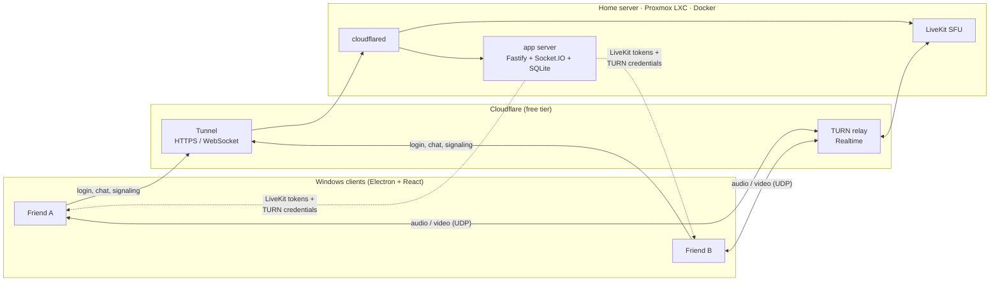

# Resenha

**A self-hosted, Discord-style voice, video and screen-sharing app for a small group of friends.**

One server, a few voice channels, and inside each channel: voice chat, screen sharing with system audio,
webcams and a text chat with history and file uploads. It ships as a lightweight Windows installer and
the whole backend runs on a single home server (a Proxmox LXC container), **without opening a single port
on the home router** and without paying for media infrastructure.

> *"Resenha"* is Brazilian slang for hanging out and chatting with friends.

---

## Features

**Voice & video**
- Voice channels with mute / deafen, speaking indicators and global hotkeys (work while the app is in the background)
- **AI noise suppression** (RNNoise, running locally in an AudioWorklet): removes fans, keyboards and street noise,
  switchable live during a call, with a built-in mic test
- **Per-user volume from 0 to 200%**, separately for voice and screen-share audio, saved locally per nickname
- Webcam and **screen sharing with system audio**, 1080p or 720p at 30 fps
- Video stage with focus mode, fullscreen and a **live stats overlay** (resolution, fps, bitrate, codec,
  hardware vs. CPU encoding, what is limiting quality, connection type, RTT, packet loss)

**Chat**
- Text chat per channel with persistent history, typing indicators and desktop notifications
- Paste screenshots (Ctrl+V) or drag & drop files; inline previews for images and videos
- **Images are optimized client-side before upload** (max 2560 px, WebP): a 9.1 MB 4K PNG becomes ~480 KB

**Desktop app**
- Electron app with a custom screen/window picker, system tray, sounds and notifications
- The server address and password are baked in at build time, so friends only type a nickname
- One-click NSIS installer

**Self-hosting**
- One script installs everything with Docker Compose
- Two deployment modes: a regular VPS with open ports, or a **home server behind NAT with no open ports**

---

## Architecture



| Component | Role |
|---|---|
| **Client** (`client/`) | Electron + React + TypeScript. Voice/video through `livekit-client`, real-time chat through Socket.IO, state in Zustand. |
| **App server** (`server/`) | Node + Fastify + Socket.IO + SQLite (`node:sqlite`). Password + nickname login (JWT), channels, messages, uploads, voice presence, LiveKit access tokens and short-lived Cloudflare TURN credentials. |
| **LiveKit** | Open-source WebRTC SFU: every participant uploads their stream once and the server forwards it to the others. |
| **Cloudflare Tunnel** | Exposes the app server and LiveKit signaling over HTTPS through an *outbound* connection, so the router needs no port forwarding (it even works behind CGNAT). |
| **Cloudflare TURN** | Relays the UDP media that the HTTP tunnel can't carry. Clients connect to the relay, and LiveKit reaches the relay from inside the home network. |

When a client is on the **same LAN as the server**, it connects to LiveKit directly instead of going out to
Cloudflare and back, so a streamer at home doesn't spend the home upload bandwidth on their own stream.

---

## Engineering highlights

Some of the more interesting problems solved along the way:

- **Media behind a NAT with no open ports.** An HTTP tunnel can't carry WebRTC media, so all media goes through a
  TURN relay. The server asks Cloudflare's API for short-lived TURN credentials and hands them to the client
  together with the LiveKit token.

- **A race condition that made joining voice take 15–25 s.** LiveKit's first connectivity checks reached the TURN
  relay *before* the client had created the relay permission for the server's IP. The relay dropped them, so the
  home router never opened the return path, and the next attempt only came 10–15 s later. Holding the client's
  ICE candidates back for 1.5 s (via a small `RTCPeerConnection` subclass) lets the permission exist first.
  **Joining now takes ~2 s.**

- **Wrong public-IP mapping inside Docker.** LiveKit sometimes mapped the public IP onto a Docker bridge interface
  instead of the LAN interface, which silently broke the TURN path. Restricting advertised IPs to the LAN ranges
  fixed it, and a watchdog script (`ip-watch.sh`) restarts LiveKit when the home IP changes or the advertised
  mapping is wrong.

- **Screen sharing capped at 2.5 Mbps / 15 fps.** LiveKit reads `screenShareEncoding` (not `videoEncoding`) for
  screen tracks, so the configured bitrate was ignored and WebRTC's default cap applied. On top of that, WebRTC's
  bandwidth estimator starts at ~300 kbps, which made every stream start at 320×180 for almost a minute. Injecting
  `x-google-start-bitrate` into the SDP fixed it: **1080p from the first second, ~50 fps on a synthetic 60 fps
  test source**.

- **RNNoise inside an Electron app served from `file://`.** `fetch()` of local files is blocked there, so the WASM
  model is inlined as a data URL and the AudioWorklet is loaded from a Blob URL (with a matching CSP). In a
  production build, it measured a **54 dB reduction** on synthetic fan noise. A bug where noise suppression played
  only in the left ear (RNNoise processes one channel; stereo mics left the right channel silent) was fixed by
  down-mixing the input to mono.

- **Per-user volume above 100%.** `HTMLMediaElement.volume` maxes out at 1.0. Up to 100% the app uses the audio
  element, which keeps the browser's echo cancellation working. Above 100% it switches that user to a Web Audio
  `GainNode`.

- **TCP vs UDP relays.** When TCP/TLS TURN candidates won the ICE race, video stuttered on every lost packet. The
  first connection attempt now offers UDP relays only, and TCP/TLS are kept as a fallback for networks that block UDP.

---

## Tech stack

**Client:** Electron 38, React 19, TypeScript, Vite (electron-vite), livekit-client, Socket.IO client, Zustand,
RNNoise (`@sapphi-red/web-noise-suppressor`), electron-builder

**Server:** Node 24, Fastify 5, Socket.IO, SQLite (`node:sqlite`), JSON Web Tokens, livekit-server-sdk

**Infrastructure:** LiveKit SFU, Docker Compose, Cloudflare Tunnel, Cloudflare Realtime TURN, Caddy (HTTPS for the
open-ports mode), Proxmox LXC

---

## Project structure

```
client/                Windows app (Electron + React)
  src/main/            Electron main process: window, tray, screen picker, global shortcuts
  src/preload/         Safe IPC bridge
  src/renderer/        React UI
    src/lib/voice.ts   LiveKit: join/leave, mic, camera, screen share, volumes, NAT workarounds
    src/lib/noise.ts   RNNoise processor and mic test
    src/lib/image.ts   Client-side image optimization
server/                App server (Fastify + Socket.IO + SQLite)
deploy/                VPS / open-ports mode: app + LiveKit + Caddy (automatic HTTPS)
deploy/cloudflare/     Home-server mode: app + LiveKit + cloudflared, no open ports
```

---

## Running locally

Requires **Node.js 22.13+** (24 LTS recommended) and the LiveKit server binary
([releases](https://github.com/livekit/livekit/releases)) extracted to `tools/livekit/`.

```bash
tools\livekit\livekit-server.exe --dev --config deploy\livekit.yaml
```

```bash
cd server
npm install
npm run dev
```

```bash
cd client
npm install
npm run dev
```

Log in with server address `localhost:3000` and password `amigos`. To simulate a second user on the same machine:

```bash
npm run dev:2
```

---

## Deploying

| Mode | Guide |
|---|---|
| **Home server, no open ports** (Proxmox + Cloudflare Tunnel + Cloudflare TURN) | [DEPLOY-PROXMOX.md](DEPLOY-PROXMOX.md) |
| **VPS or server with open ports** (self-hosted LiveKit, automatic HTTPS with Caddy) | [DEPLOY.md](DEPLOY.md) |

Each mode has an `install.sh` that installs Docker, asks for the server password and credentials (prompts are in
Portuguese; the guides translate them), generates the secrets and starts the stack.

To build the Windows installer with the server address embedded, copy `client/.env.example` to `client/.env`,
fill in `VITE_SERVER_URL` and `VITE_SERVER_PASSWORD`, and run:

```bash
cd client
npm run dist
```

The macOS build (Apple Silicon / arm64 only) has to run on a Mac: `npm run dist:mac` there, or run the
**Build macOS** workflow in GitHub Actions (set the `VITE_SERVER_URL` and `VITE_SERVER_PASSWORD` repository secrets
first) and download the `.dmg` from the run's artifacts. The app is ad-hoc signed, not notarized, so on first launch
macOS blocks it: right-click the app → **Open**, or run `xattr -cr /Applications/Resenha.app`.

All secrets (`.env` files) are git-ignored; only `*.env.example` templates are committed.

---

## Limitations

- **Bandwidth:** the SFU runs at home, so every viewer's copy of a stream leaves through the home upload
  (~10 Mbps per viewer at 1080p30, ~5 Mbps at 720p30; up to ~20 and ~10 Mbps in "games and video" mode).
- **TURN quota:** Cloudflare's free tier covers 1,000 GB/month of relayed media, which is plenty for voice and
  several hours of screen sharing per day.
- **System audio capture:** the app asks Chromium to exclude its own audio from the loopback capture. Depending on
  the Windows/Chromium version, other participants' voices could leak into a shared stream. The planned fix is a
  native module using Windows' process-loopback exclusion.
- **Windows only** for now, and the installer is not code-signed.
